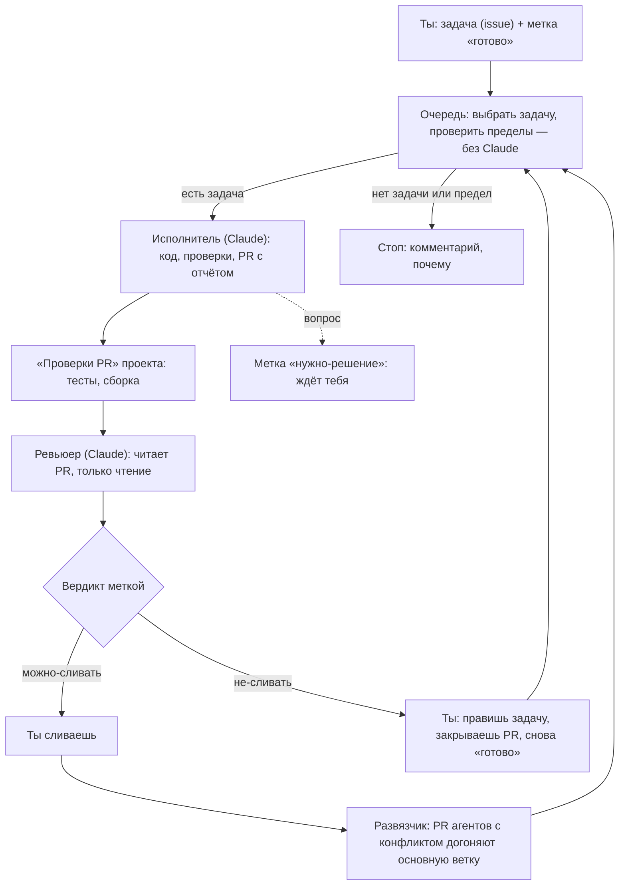
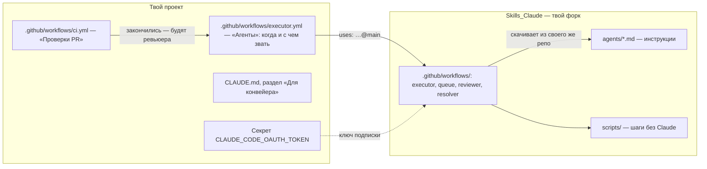

# Гайд агентов: как устроено и как подключить к своему проекту

Для друзей, которые хотят, чтобы в их репозитории код писали агенты: ставишь задачу, агент присылает PR (предложение правки), другой агент его проверяет, сливаешь ты. Этап 7 Штаба: Ш-129, Ш-132…Ш-134. Приложения семьи и как сделать свою копию приложения — отдельный гайд: `goigolden88/FamilyCore`, `docs/Гайд.md`.

> **Честно о готовности.** Агенты работают каждый день в наших репозиториях. Но связку «чужой аккаунт GitHub → его форк `Skills_Claude` → его проект» мы целиком не запускали: ты — первый. Код мы проверили по чтению, но что-то может пойти не так, как написано здесь. Тогда разбирай с Claude Code: покажи ему шаг, ошибку или сводку прогона (раздел «Вместе с Claude» ниже) — и напиши нам, что случилось: поправим гайд и агентов.

Слова, которые встретятся:

- **Workflow** — файл автоматизации GitHub в `.github/workflows/`: «когда случилось X — выполни шаги». Здесь агенты — это workflow, внутри которых работает Claude Code.
- **Метка** (label) — ярлык на задаче или PR. Метками ты управляешь агентами: `готово` — бери в работу.
- **GitHub App «Claude»** — приложение, через которое Claude пишет в твой репозиторий от своего имени (`claude[bot]`).
- **Секрет** — значение, которое workflow видит, а люди и логи — нет. Здесь — ключ твоей подписки Claude.

## Как устроено



Кто что делает:

| Агент | Когда | Что делает | Предел ходов |
|---|---|---|---|
| Исполнитель | метка `готово` от владельца репо; слияние PR | берёт одну задачу, пишет код, гоняет проверки, открывает PR с отчётом | 100, `крупная` — 200 |
| Ревьюер | закончились «Проверки PR» на PR агента | читает дифф и задачу, отдаёт вердикт; сам в GitHub не пишет — метку ставит скрипт | 40, `крупная` — 80 |
| Развязчик | слит любой PR | вливает основную ветку в PR агента с конфликтом; не уверен — комментарий тебе | — |
| Спецификатор | не workflow — правила | как превратить сырую просьбу в задачу, которую агент сделает без вопросов: `agents/specifier.md` | — |

Пределы ходов в таблице (и модель, и усилие) — **наши числа**, подобранные на наших задачах и нашей подписке. Под свои задачи их стоит поправить — раздел «Свои пределы и модели» ниже.

Сливает только человек — это правило конвейера, а не настройка: агенты не нажимают «Merge».

### Чего в этом наборе нет: ретро, аналитик, консультант

У нас вокруг конвейера работают ещё три агента. Они не workflow, а **Routine** — задание по расписанию в claude.ai, которое будит отдельную сессию Claude; их промпты лежат в нашем закрытом репо процесса и завязаны на его документы, поэтому в форк не попадают.

| Агент | Когда | Что делает |
|---|---|---|
| Ретро | раз в неделю | разбирает прогоны недели (ходы, расход, вердикты, ошибки) и предлагает правки инструкций агентов — самообучение конвейера |
| Аналитик | раз в неделю | читает планы проектов и предлагает задачи меткой `предложение`; твоё `готово` — согласие |
| Консультант | раз в месяц | смотрит на проекты и процесс целиком: новые идеи, связи между проектами, что упростить |

Без них конвейер работает полностью: задачи ставишь ты, агенты их делают. Захочешь такого у себя — попроси нас промпт (отдадим общий, без наших проектов) или собери свой с Claude Code: Routine заводится в claude.ai/code.

### Где что лежит



- **Проект** держит короткий файл «Агенты» (когда звать и с какими настройками), свои «Проверки PR», секрет и раздел «Для конвейера» в `CLAUDE.md` — что агенту нужно знать именно про этот проект: как поставить зависимости, какие проверки, что трогать только через тебя.
- **Skills_Claude** держит сами workflow, инструкции агентов и скрипты. Агенты общие для любых проектов: о проекте они узнают только из его `CLAUDE.md` и `docs/`.

### Метки

| Метка | Кто ставит | Значит |
|---|---|---|
| `готово` | ты | можно брать в работу; работает только от владельца репо |
| `в-работе` | очередь | исполнитель взял; один исполнитель на репо |
| `нужно-решение` | агент | ждёт тебя: вопрос в комментарии; очередь задачу пропускает |
| `можно-сливать` / `не-сливать` | ревьюер | вердикт, объяснение — в его комментарии |
| `p1`, `p2`, `p3` | ты | порядок: сначала `p1`; без метки — после; при равных — старшая задача |
| `крупная` | ты | предел ходов 200 вместо 100 |
| `sonnet`, `opus` | ты | модель вместо модели по умолчанию |
| `medium`, `xhigh` | ты | усилие вместо `high` |
| `пара` | ты | своя ветка: PR по задаче не останавливает следующую |
| `сверх-предела` | ты | задача идёт сверх суточного предела PR |
| `предложение` | аналитик | задачу предложил агент; твоё `готово` — согласие |

В тексте задачи строка «после #N» — задача ждёт, пока не слит PR задачи #N, и стартует сама после его слияния.

### Предохранители

- **Пределы PR:** за одно пробуждение — до 5 задач подряд; за сутки — 8 PR агентов на репо и 10 на все твои репо; открытых PR агентов — не больше 10.
- **Лимит подписки:** если в прогоне пришло «лимит близко», очередь после этой задачи останавливается и пишет в задачу, какой лимит: окно (5 часов) или неделя. Недельный — это может быть несколько дней: до сброса каждый прогон будет кончаться таким стопом. Остаток лимита — claude.ai → «Settings» → «Usage».
- **Права:** исполнитель не сливает, ревьюер только читает; команды, которые агенту можно запускать, задаёт проект (`project-tools`).
- **Остановить всех** — «Actions» → «Агенты» → «…» → «Disable workflow». Включить — там же.
- **Замер:** в сводке каждого прогона (Actions → прогон → Summary) — ходы, время, модель, отказы в правах, последние слова агента.

## Почему форк

Ты можешь подключить проект прямо к нашему `goigolden88/Skills_Claude@main`. Тогда **наша правка агентов приходит к тебе в тот же час — и наша ошибка тоже**: мы правим под свои задачи и проверяем на своих проектах, не на твоих.

Рекомендуем **форк** `Skills_Claude` — свою версию агентов:

- свои пределы, модели и правила — под свои задачи;
- наши улучшения — когда сам захочешь: на странице форка «Sync fork» → «Update branch»;
- workflow скачивают инструкции и скрипты из того репо, где лежат сами (`job.workflow_repository`), — у форка из форка. Наш `main` твоих агентов не меняет.

## Подключение по шагам

Нужны: аккаунт GitHub, подписка Claude (Pro или Max — агенты тратят её лимиты), репозиторий проекта и компьютер (Mac, Windows или Linux) — ключ подписки получают только там.

### 0. Что поставить на компьютер

- **Claude Code** — Claude в терминале. Установка — с code.claude.com (на Mac — одна команда в «Терминале» с этой страницы), затем `claude` и вход своей подпиской.
- **git** — на Mac `xcode-select --install`; на Windows — git-scm.com.
- **gh** — GitHub в терминале: cli.github.com → установщик (на Mac можно `brew install gh`), затем `gh auth login` → «GitHub.com» → вход через браузер.

Проверка: `claude --version`, `git --version`, `gh auth status` — все три отвечают без ошибки.

### Вместе с Claude

Шаги 1–2 ниже можно не делать руками: в папке, где будешь работать, запусти `claude` и вставь, заполнив `<…>`:

```
Подключи агентов к моему проекту <твой-логин>/<проект> по гайду
https://github.com/goigolden88/Skills_Claude/blob/main/docs/гайд-агентов.md
Прочитай его целиком и веди по «Подключению по шагам».

Делай сам то, что делается командами git и gh: форк Skills_Claude, замену
владельца в строках uses:, connect-project.sh (сначала с DRY_RUN=1 — покажи,
что будет сделано, и жди моего «да»), раздел «Для конвейера» в CLAUDE.md
проекта, PR.
Мне оставь два шага и объясняй их по одному: установить GitHub App «Claude»
на репо проекта и вписать секрет CLAUDE_CODE_OAUTH_TOKEN. Ключ подписки
не проси и не повторяй — я впишу его сам, в отдельном терминале.

Гайд проверен не целиком: если шаг идёт не так, как в нём написано, —
остановись, разберись по ошибке или сводке прогона, объясни мне простыми
словами и предложи, как дальше. Ничего не удаляй и не меняй в настройках
репо без моего «да».
```

Ключ подписки — единственное, что Claude видеть не должен: с ним агенты тратят твою подписку. Поэтому секрет вписываешь ты — в браузере (шаг 2.2) или командой в отдельном терминале, которая сама спросит значение и не покажет его:

```
gh secret set CLAUDE_CODE_OAUTH_TOKEN -R твой-логин/проект
```

Первую задачу (шаг 3) Claude тоже напишет: попроси «напиши задачу по agents/specifier.md: <что хочу>».

### 1. Форк Skills_Claude и свой владелец

1. `github.com/goigolden88/Skills_Claude` → «Fork».
2. В форке — «Actions» → «I understand my workflows, go ahead and enable them». Сами по себе в форке ничего не запускаются: все его workflow только вызываются из проектов.
3. **Заменить владельца в трёх строках.** Внутри `executor.yml` и `resolver.yml` есть вызовы `uses: goigolden88/Skills_Claude/…@main` — GitHub не даёт писать их подстановкой, поэтому после форка они всё ещё смотрят на нас. Рядом с каждой — пометка. В клоне своего форка:

   ```
   sed -i 's#uses: goigolden88/Skills_Claude/#uses: ТВОЙ-ЛОГИН/Skills_Claude/#' \
     .github/workflows/executor.yml .github/workflows/resolver.yml
   grep -n "uses: .*/Skills_Claude/" .github/workflows/*.yml
   git commit -am "Агенты — из моего форка" && git push
   ```

   На Mac — `sed -i ''`. Без терминала — в браузере: файл → карандаш → заменить `goigolden88` на свой логин в строках `uses:` → «Commit changes».

   Если мы когда-нибудь поменяем эти строки, «Sync fork» покажет конфликт ровно в них — оставь свой логин.

### 2. Проект

1. **Доступ App:** `github.com/apps/claude` → «Install» (или «Configure», если уже стоит) → выбери репозиторий проекта.
2. **Секрет:** на компьютере с Claude Code — `claude setup-token`, войти своей подпиской, скопировать токен. Затем репозиторий проекта → «Settings» → «Secrets and variables» → «Actions» → «New repository secret»: имя `CLAUDE_CODE_OAUTH_TOKEN`, значение — токен (или `gh secret set`, раздел «Вместе с Claude»). Никуда больше его не вставляй; GitHub покажет его один раз — сохрани в менеджер паролей, если подключишь ещё проекты.

   Ключ не вечный: по описаниям — около года, запиши дату выпуска. Кончился — прогоны падают на шаге Claude с ошибкой входа (`401`, «authentication»), а задача остаётся в `в-работе`. Тогда — снова `claude setup-token` и новое значение секрета в каждом проекте.
3. **Файлы и метки — одной командой** из клона своего форка:

   ```
   DRY_RUN=1 bash scripts/connect-project.sh ТВОЙ-ЛОГИН/проект --node 24 --chrome
   bash scripts/connect-project.sh ТВОЙ-ЛОГИН/проект --node 24 --chrome
   ```

   Первая строка только показывает, что будет сделано. Скрипт заводит метки, шаблон задачи, файл «Агенты» (в нём — твой форк: скрипт берёт его из клона, откуда запущен; `AGENTS_REPO=логин/репо` — задать явно), «Проверки PR» по шаблону Node, если своих нет, и заготовку раздела «Для конвейера» — одним PR. `--node` — версия Node (пусто — не ставится), `--chrome` — Chrome для проверки в браузере, `--tools "Bash(...),..."` — команды, которые агенту можно запускать (по умолчанию `npm ci`, `npm test`, `npm run`), `--protect` — защита основной ветки: только через PR и с зелёными проверками.
4. **Раздел «Для конвейера»** в `CLAUDE.md` проекта — дописать в том же PR: как поставить зависимости, какие проверки гонять, что агенту трогать только через `нужно-решение` (данные пользователей, зависимости, `.github/`), где данные, которые нельзя открывать. Это делает Claude Code в обычной сессии по заготовке.
5. Слить PR.

**Имя «Проверки PR» — обязательное.** Ревьюер просыпается, когда закончился workflow ровно с этим именем (`name: Проверки PR` в начале файла). Свои проверки под другим именем — переименуй, иначе ревьюер PR не увидит.

**Проект — форк нашего приложения?** В нём уже есть файл «Агенты» со ссылками на `goigolden88/Skills_Claude` — скрипт его не трогает. Замени владельца так же, как в шаге 1.3, в `.github/workflows/executor.yml` проекта.

### 3. Первая задача

1. Issue по шаблону «Задача»: что хочешь, как поймёшь, что готово, что нельзя трогать. Чем точнее «как пойму, что готово» — тем меньше вопросов от агента. Как писать задачи — `agents/specifier.md`; можно попросить Claude Code написать задачу по нему.
2. Метка `готово`.
3. Через 10–30 минут — PR с отчётом и вердикт ревьюера. Смотри «Actions» → «Агенты», если что-то пошло не так: в сводке прогона написано, где остановился.

## Свои пределы и модели

Наши числа — классы задач, пределы ходов (100, `крупная` — 200), модель и усилие, пересчёт расхода в доли лимита подписки — подобраны на наших задачах (статические приложения без сервера) и нашем плане подписки. У тебя они свои (Ш-118). Задаются входами в файле «Агенты» проекта, в вызове `executor.yml`:

```yaml
    with:
      model: claude-sonnet-5-5   # модель по умолчанию
      effort: medium             # усилие вместо high
      max-turns: 60              # предел ходов задачи
      big-turns: 120             # предел с меткой «крупная»
```

Суточные пределы PR — в `scripts/queue-pick.sh` твоего форка (`MAX_REPO_DAY`, `MAX_ALL_DAY`, `MAX_OPEN`). Первые прогоны идут на наших числах — сверь по сводкам и поправь.

## Проект с сервером

Агенты от стека не зависят: проверки и разрешённые команды задаёт проект. Под статику заточены четыре места — окружение проверок (база и сервисы в CI), откат (Revert не отыгрывает миграцию серверной базы: миграции и выкатку — только через тебя), секреты (агенту — только тестовые), ревью (доступ, валидация, SQL, API — правилами в `CLAUDE.md` проекта). Это настраиваешь у себя сам, через Claude Code (Ш-117).

## Codex и открытые модели

Агенты и инструкции оптимизированы под Claude. Перейти на Codex или открытую модель можно: инструкции в `agents/*.md` — обычный текст, меняется обвязка — шаг с `anthropics/claude-code-action` в workflow на Action своей модели, `AGENTS.md` в проекте со ссылкой на `CLAUDE.md`, своя подписка или ключ, имена инструментов в разрешениях, пределы и замер расхода. Подробно — по запросу (Ш-133).

## Если застрял

Пиши, на каком шаге и что в сводке прогона. Каждый вопрос — повод поправить этот гайд.
